# Protokol o analýze — Střelecká úspěšnost (VMM)

_Vygenerováno skriptem `src/analysis.py` 2026-10-19 21:30, α = 0.05, náhodné seed = 42._

## 1. Předzpracování dat

Načteno **1000** záznamů o střelách (12 střelců, 301 zápasů, sezóny 2014–2020). Souřadnice X, Y byly v souboru v rozsahu 0–1, podle zadání jsme je přeškálovali na 100 × 100 jednotek hřiště. Z analýzy jsme vyloučili **2** záznamy, které nedávají smysl pro pokus o gól na brance soupeře (důvody: Vlastní gól — rána na vlastní branku).

**Vyloučené záznamy**

| id          | player       | result   | X      | Y       | xG     | duvod_vyradeni                       |
|:------------|:-------------|:---------|:-------|:--------|:-------|:-------------------------------------|
| 117395,0000 | Tyrone Mings | OwnGoal  | 8,8000 | —       | 0,0000 | Vlastní gól — rána na vlastní branku |
| 117476,0000 | Tyrone Mings | OwnGoal  | 3,4000 | 47,0000 | 0,0000 | Vlastní gól — rána na vlastní branku |

**Přehled chybějících hodnot**

| sloupec     | chybi    | podil_radku   |
|:------------|:---------|:--------------|
| X           | 98,0000  | 0,0982        |
| Y           | 177,0000 | 0,1774        |
| dist_line_m | 98,0000  | 0,0982        |
| dist_m      | 263,0000 | 0,2635        |
| angle_rad   | 263,0000 | 0,2635        |
| angle_deg   | 263,0000 | 0,2635        |

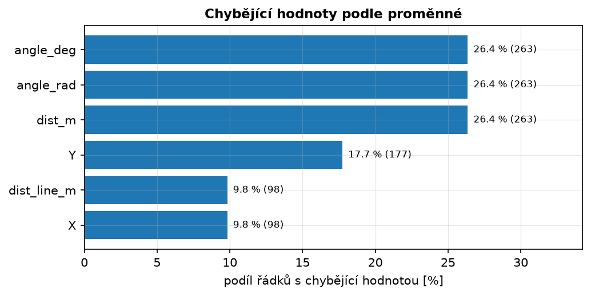

*Obrázek: Chybějící hodnoty podle proměnné*

**Ověření MCAR předpokladu pro chybějící souřadnice**

| test                                                                | statistika   | p-hodnota   | rozdil_prumeru_xG   | uspěšnost_gól_plné   | úspěšnost_gól_bez_souradnic   |
|:--------------------------------------------------------------------|:-------------|:------------|:--------------------|:---------------------|:------------------------------|
| Mann–Whitney U — xG (úplné vs. neúplné souřadnice)                  | 92924,0000   | 0,3527      | -0,0066             | 0,0857               | 0,1027                        |
| Chi-kvadrát nezávislosti — chybějící souřadnice × výsledek (df = 4) | 0,9258       | 0,9208      | —                   | 0,0857               | 0,1027                        |

Kategorické proměnné `shotType`, `lastAction` a `player_assisted` jsme doplnili vlastní kategorií **„Neznámý“** — chybějící záznam sám o sobě nese informaci (typicky střela bez přihrávky). U souřadnic X, Y jsme **neprováděli imputaci**: geometrické veličiny (vzdálenost, úhel) z nich odvozené by imputace uměle nahnala k průměru a zkreslila ordinační i shlukové metody. Ordinační a shlukové analýzy proto běží na **735** střelách s úplnými souřadnicemi; modely úspěšnosti využívají všech 998 záznamů a chybějící souřadnice je v nich zastoupena příznakem „neuplné souřadnice“ (sensitivity viz H4).

Obě testy MCAR prokázaly, že se řádky bez souřadnic neliší v xG ani ve výsledcích (obě p > 0,05) → chybějící hodnoty považujeme za náhodné a jejich vynechání neposouvá závěry.

**Popisná statistika po vyčištění**

| proměnná                 | šikmost   | špičatost   | count    | mean    | std     | min     | 25%     | 50%     | 75%     | max      |
|:-------------------------|:----------|:------------|:---------|:--------|:--------|:--------|:--------|:--------|:--------|:---------|
| minuta zápasu            | -0,0878   | -1,1297     | 998,0000 | 49,8477 | 26,8203 | 0,0000  | 28,0000 | 51,0000 | 73,0000 | 96,0000  |
| xG (očekávané góly)      | 2,8963    | 8,3537      | 998,0000 | 0,0915  | 0,1334  | 0,0086  | 0,0241  | 0,0463  | 0,0820  | 0,7612   |
| vzdálenost od branky [m] | -0,1584   | -0,7845     | 735,0000 | 19,7233 | 6,9173  | 2,8358  | 14,3644 | 19,9836 | 25,3388 | 38,1151  |
| úhel odkrytý brankou [°] | 2,5512    | 8,5438      | 735,0000 | 21,3002 | 11,8381 | 6,4789  | 14,4281 | 16,8719 | 23,9612 | 104,4661 |
| X [jednotky hřiště]      | -0,0197   | -0,9285     | 900,0000 | 83,7147 | 6,9962  | 66,1000 | 77,8750 | 84,2500 | 89,0250 | 98,7000  |
| Y [jednotky hřiště]      | -0,0480   | -0,8668     | 821,0000 | 50,6604 | 13,6909 | 10,9000 | 39,4000 | 50,7000 | 61,7000 | 87,9000  |
| střela proměněna (0/1)   | 2,8615    | 6,1880      | 998,0000 | 0,0902  | 0,2866  | 0,0000  | 0,0000  | 0,0000  | 0,0000  | 1,0000   |
| střela na branku (0/1)   | 0,6304    | -1,6027     | 998,0000 | 0,3497  | 0,4771  | 0,0000  | 0,0000  | 0,0000  | 1,0000  | 1,0000   |

**Výsledky střel**

| výsledek          | počet_střel   | úspěšnost   | průměrné_xG   |
|:------------------|:--------------|:------------|:--------------|
| Zablokovaná       | 329,0000      | 0,0000      | 0,0589        |
| Vedle branky      | 320,0000      | 0,0000      | 0,0697        |
| Chycená brankářem | 240,0000      | 0,0000      | 0,0916        |
| Gól               | 90,0000       | 1,0000      | 0,2555        |
| Tyč/břevno        | 19,0000       | 0,0000      | 0,2421        |

Celková úspěšnost střel je **9.0 %**; na branku šlo 35.0 % střel. Součet xG je 91.3 oproti 90 vstřeleným gólům (model xG tedy o 1 % nadhodnocuje skutečnost), což je další připomínka, že xG je pouze odhad kvality šance — nikoli vysvětlený výsledek.

Zvlášť jsme označili **6** pokutových kopů: poloha i xG jsou degenerované (X = 88.5, Y = 50.0, xG = 0.761 pro všechny), úspěšnost 50 %. V ordinačních a shlukových metodách by vytvořily umělý shluk (jedno stanovisko s nulovou variabilitou), proto z nich jsou vynechány; u modelů úspěšnosti je uvádíme zvlášť.

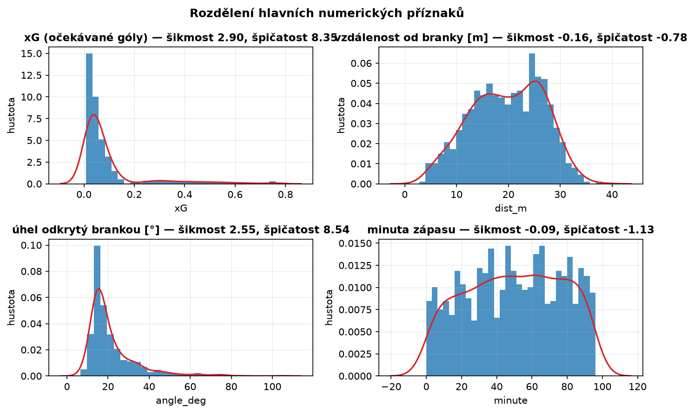

*Obrázek: Rozdělení numerických příznaků*

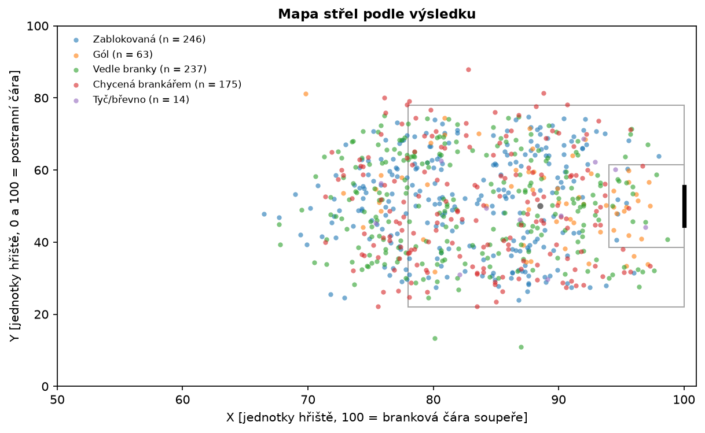

*Obrázek: Postavení střel na hřišti podle výsledku*

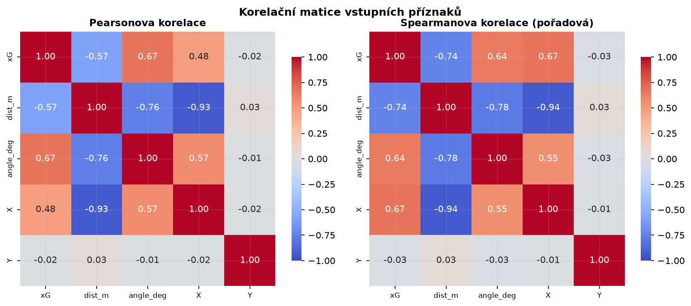

*Obrázek: Korelační matice příznaků*

Silné lineární vazby (|r| ≥ 0,5) naznačují multikolinearitu, kterou musíme při regresním modelování respektovat (VIF v H4): xG (očekávané góly)–vzdálenost od branky [m] (r = -0.57), xG (očekávané góly)–úhel odkrytý brankou [°] (r = +0.67), vzdálenost od branky [m]–úhel odkrytý brankou [°] (r = -0.76), vzdálenost od branky [m]–X [jednotky hřiště] (r = -0.93), úhel odkrytý brankou [°]–X [jednotky hřiště] (r = +0.57). Geometrické veličiny jsou navzájem dány transformací ze stejných souřadnic, čisté uspořádání dat nám tedy nabízí spolehlivou redundanci — přesně situace, kdy má smysl redukce dimenze (H2).

Odlehlé hodnoty jsme hledali Mahalanobisovou vzdáleností ve standardizovaném prostoru proměnných xG (očekávané góly), vzdálenost od branky [m], úhel odkrytý brankou [°], X [jednotky hřiště], Y [jednotky hřiště] (p = 5). Kritická mez je **17,96** — 99,7. kvantil χ²(5), obdoba pravidla 3σ pro vícerozměrná data. Nad mezí je **29** z 735 střel (3.9 %). Jde o jev, který vysvětluje šikmost rozdělení (xG šikmost 3.06): extrémy nejsou chyba měření, ale reálné „nejlehčí“ (penalty, dorážky z nulové vzdálenosti) a „nejobtížnější“ (velká vzdálenost, malý úhel) šance. **Neodstraňujeme je** — byly by to obsahově nejzajímavější střely; jen je označujeme a klíčové testy opakujeme i bez nich (sensitivity viz jednotlivé hypotézy).

**Nejvíc odlehlé střely (nad kritickou mezí)**

| id          | player          | result      | situation      | xG     | dist_m   | angle_deg   | D2      |
|:------------|:----------------|:------------|:---------------|:-------|:---------|:------------|:--------|
| 325568,0000 | Jack Grealish   | Goal        | OpenPlay       | 0,7087 | 2,8358   | 104,4661    | 94,4095 |
| 260681,0000 | Bertrand Traoré | MissedShots | DirectFreekick | 0,0381 | 29,8872  | 6,4789      | 51,8967 |
| 279834,0000 | Douglas Luiz    | MissedShots | SetPiece       | 0,0975 | 4,4212   | 75,5236     | 49,7173 |
| 249190,0000 | Ross Barkley    | Goal        | SetPiece       | 0,7394 | 4,0167   | 84,5006     | 49,4748 |
| 213811,0000 | Bertrand Traoré | Goal        | FromCorner     | 0,1501 | 4,5448   | 76,0417     | 45,0030 |
| 219832,0000 | Bertrand Traoré | BlockedShot | FromCorner     | 0,0859 | 4,8686   | 73,7461     | 43,9941 |
| 17047,0000  | Ross Barkley    | SavedShot   | OpenPlay       | 0,0150 | 31,4700  | 7,7062      | 36,4001 |
| 55485,0000  | Ross Barkley    | Goal        | Penalty        | 0,7612 | 12,0750  | 33,7247     | 35,7366 |
| 20486,0000  | Ross Barkley    | SavedShot   | Penalty        | 0,7612 | 12,0750  | 33,7247     | 35,7366 |
| 55488,0000  | Ross Barkley    | Goal        | Penalty        | 0,7612 | 12,0750  | 33,7247     | 35,7366 |
| 384970,0000 | Ollie Watkins   | Goal        | Penalty        | 0,7612 | 12,0750  | 33,7247     | 35,7366 |
| 337075,0000 | Jack Grealish   | ShotOnPost  | Penalty        | 0,7612 | 12,0750  | 33,7247     | 35,7366 |

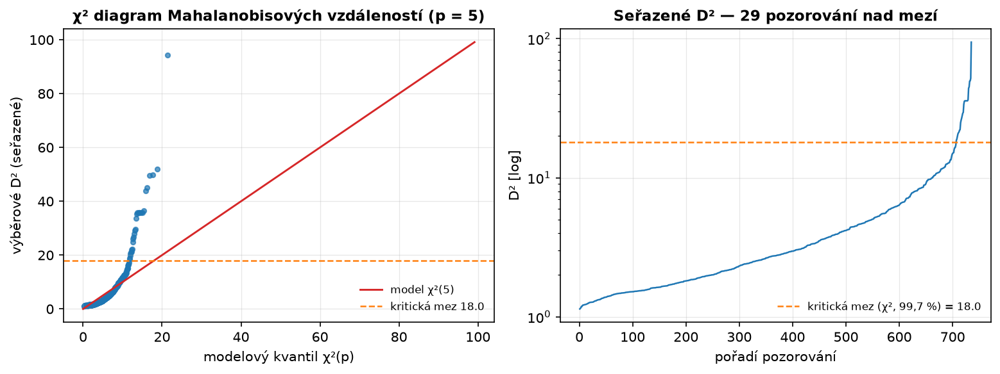

*Obrázek: χ² diagram Mahalanobisových vzdáleností*

**Testy normality (Shapiro–Wilk na náhodné pětisetovce — u velkého souboru orientační)**

| proměnná                 | šikmost   | špičatost   | Shapiro–Wilk W   | Shapiro–Wilk p   |
|:-------------------------|:----------|:------------|:-----------------|:-----------------|
| xG (očekávané góly)      | 2,8963    | 8,3537      | 0,5856           | 0,0000           |
| vzdálenost od branky [m] | -0,1584   | -0,7845     | 0,9810           | 0,0000           |
| úhel odkrytý brankou [°] | 2,5512    | 8,5438      | 0,7402           | 0,0000           |
| X [jednotky hřiště]      | -0,0197   | -0,9285     | 0,9796           | 0,0000           |
| Y [jednotky hřiště]      | -0,0480   | -0,8668     | 0,9773           | 0,0000           |

Vícerozměrný test normality (Székely–Rizzo, pingouin) dává W = 29,747, p < 0,001 → vícerozměrné normální rozdělení **zamítáme**. Pro PCA to není kritické (je to algebraická metoda), ale omezuje to χ² testy a Mahalanobisovu vzdálenost; proto u neparametricky citlivých rozhodnutí doplňujeme pořadové a permutační varianty (Spearman, Kruskal–Wallis, bootstrap).

**Transformační konstanty standardizace (uchovány pro inferenci)**

| proměnná                 | průměr   | směrodatná_odchylka   |
|:-------------------------|:---------|:----------------------|
| xG (očekávané góly)      | 0,0915   | 0,1334                |
| vzdálenost od branky [m] | 19,7233  | 6,9126                |
| úhel odkrytý brankou [°] | 21,3002  | 11,8301               |
| X [jednotky hřiště]      | 83,7147  | 6,9923                |
| Y [jednotky hřiště]      | 50,6604  | 13,6826               |

---

## Vyhodnocení hypotéz

Všechny testy běží na hladině významnosti **α = 0.05** (p < 0.05 → H0 zamítáme). Kritické hodnoty a testy vycházejí z přednášek VMM (ANOVA/MANOVA VMM-4, PCA VMM-6 a VMM-9, shlukování VMM-5, logitní model VMM-7, t-SNE VMM-10).

## 2. H1 — vliv typu zakončení a herní situace na parametry střely

**H0:** střední hodnoty parametrů střely (xG, vzdálenost od branky, úhel pohledu) jsou ve všech typech zakončení i herních situacích shodné. **H1:** alespoň jedna skupina se liší. Do srovnání bereme jen kategorie s alespoň 30 střelami; kód „Neznámý“ (chybějící údaj) řadíme stranou, nebo by uměle zvětšoval rozptyl uvnitř skupin.

### Typ zakončení (shotType) — 819 střel, 3 kategorií

**Parametr xG (očekávané góly) podle faktoru zakonceni**

| skupina    | n        | průměr   | směrodatná odchylka   | medián   | 1. kvartil   | 3. kvartil   | minimum   | maximum   |
|:-----------|:---------|:---------|:----------------------|:---------|:-------------|:-------------|:----------|:----------|
| Hlava      | 72,0000  | 0,1083   | 0,1404                | 0,0551   | 0,0297       | 0,1142       | 0,0090    | 0,6492    |
| Pravá noha | 384,0000 | 0,0878   | 0,1430                | 0,0414   | 0,0225       | 0,0751       | 0,0103    | 0,7612    |
| Levá noha  | 363,0000 | 0,0874   | 0,1155                | 0,0505   | 0,0273       | 0,0866       | 0,0088    | 0,6865    |

- **Jednocestná ANOVA: xG (očekávané góly) ~ zakonceni**: F(2, 816) = 0,82, η² = 0,002, ω² = -0,000, p = 0,4427 → na α = 0,05 **H0 nezamítáme** (efekt prokázán nebyl) — rozdělení je zešikmené → ANOVA doplňována Kruskal–Wallisem a Welchovou verzí
- **Leveneův test homogenity rozptylů: xG (očekávané góly)**: F = 0,87, p = 0,4203 → na α = 0,05 **H0 nezamítáme** (efekt prokázán nebyl) — nezamítnutí podporuje klasickou ANOVA
- **Kruskal–Wallisův test: xG (očekávané góly)**: H = 9,00, p = 0,0111 → na α = 0,05 **H0 zamítáme** (efekt prokázán) — shodný závěr s ANOVA → výsledek není dán zešikmením
**Diagnostika předpokladů (normalita po skupinách): xG (očekávané góly)**

| faktor    | proměnná            | skupina    | n        | šikmost   | špičatost   | Shapiro–Wilk p   |
|:----------|:--------------------|:-----------|:---------|:----------|:------------|:-----------------|
| zakončení | xG (očekávané góly) | Pravá noha | 384,0000 | 3,2285    | 10,2231     | 0,0000           |
| zakončení | xG (očekávané góly) | Levá noha  | 363,0000 | 3,0152    | 9,5404      | 0,0000           |
| zakončení | xG (očekávané góly) | Hlava      | 72,0000  | 2,2802    | 4,6007      | 0,0000           |

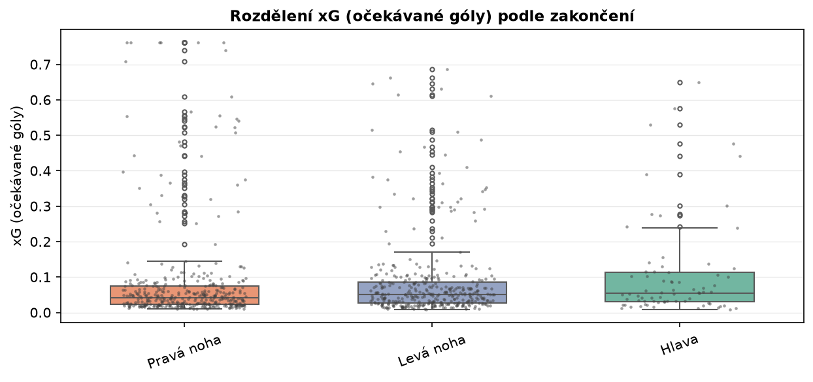

*Obrázek: xG (očekávané góly) podle zakončení*

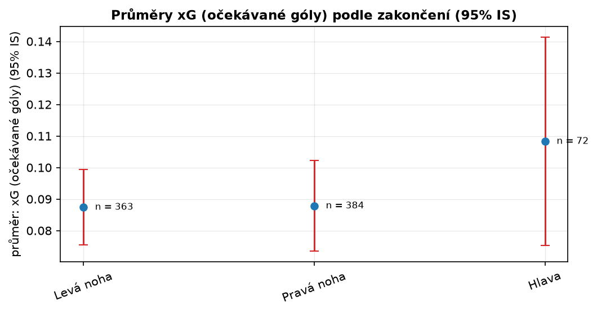

*Obrázek: xG (očekávané góly) podle zakončení*

**Parametr vzdálenost od branky [m] podle faktoru zakonceni**

| skupina    | n        | průměr   | směrodatná odchylka   | medián   | 1. kvartil   | 3. kvartil   | minimum   | maximum   |
|:-----------|:---------|:---------|:----------------------|:---------|:-------------|:-------------|:----------|:----------|
| Pravá noha | 384,0000 | 20,8857  | 6,4666                | 21,4712  | 16,2058      | 25,9527      | 2,8358    | 38,1151   |
| Levá noha  | 363,0000 | 19,9237  | 6,3776                | 19,9269  | 15,2743      | 24,8247      | 4,5448    | 34,5698   |
| Hlava      | 72,0000  | 10,9566  | 2,9401                | 10,9421  | 8,6502       | 13,2830      | 4,8686    | 16,8130   |

- **Jednocestná ANOVA: vzdálenost od branky [m] ~ zakonceni**: F(2, 603) = 52,75, η² = 0,149, ω² = 0,146, p < 0,001 → na α = 0,05 **H0 zamítáme** (efekt prokázán) — předpoklady ANOVA jsou v rozumné míře splněny
- **Leveneův test homogenity rozptylů: vzdálenost od branky [m]**: F = 15,55, p < 0,001 → na α = 0,05 **H0 zamítáme** (efekt prokázán) — nezamítnutí podporuje klasickou ANOVA
- **Kruskal–Wallisův test: vzdálenost od branky [m]**: H = 88,67, p < 0,001 → na α = 0,05 **H0 zamítáme** (efekt prokázán) — shodný závěr s ANOVA → výsledek není dán zešikmením
**Tukey HSD — prokázané rozdíly: vzdálenost od branky [m] (zakonceni)**

| skupina A   | skupina B   | rozdíl průměrů   | dolní mez 95 %   | horní mez 95 %   | p-hodnota   | rozdíl prokázán   |
|:------------|:------------|:-----------------|:-----------------|:-----------------|:------------|:------------------|
| Hlava       | Levá noha   | 8,9672           | 6,6784           | 11,2559          | 0,0000      | ano               |
| Hlava       | Pravá noha  | 9,9291           | 7,6488           | 12,2095          | 0,0000      | ano               |

**Diagnostika předpokladů (normalita po skupinách): vzdálenost od branky [m]**

| faktor    | proměnná                 | skupina    | n        | šikmost   | špičatost   | Shapiro–Wilk p   |
|:----------|:-------------------------|:-----------|:---------|:----------|:------------|:-----------------|
| zakončení | vzdálenost od branky [m] | Pravá noha | 286,0000 | -0,3161   | -0,4634     | 0,0010           |
| zakončení | vzdálenost od branky [m] | Levá noha  | 272,0000 | -0,0885   | -0,4960     | 0,0740           |
| zakončení | vzdálenost od branky [m] | Hlava      | 48,0000  | -0,0199   | -0,7676     | 0,5827           |

![vzdálenost od branky [m] podle zakončení](12_zakonceni_dist_m.png)

*Obrázek: vzdálenost od branky [m] podle zakončení*

![vzdálenost od branky [m] podle zakončení](13_zakonceni_dist_m.png)

*Obrázek: vzdálenost od branky [m] podle zakončení*

**Parametr úhel odkrytý brankou [°] podle faktoru zakonceni**

| skupina    | n        | průměr   | směrodatná odchylka   | medián   | 1. kvartil   | 3. kvartil   | minimum   | maximum   |
|:-----------|:---------|:---------|:----------------------|:---------|:-------------|:-------------|:----------|:----------|
| Hlava      | 72,0000  | 36,7349  | 11,4475               | 32,8616  | 29,2589      | 43,0665      | 21,7485   | 73,7461   |
| Levá noha  | 363,0000 | 20,1021  | 9,8176                | 16,8313  | 14,6618      | 22,4674      | 6,4789    | 76,5061   |
| Pravá noha | 384,0000 | 19,2282  | 10,5754               | 15,9699  | 14,0209      | 20,3929      | 7,4476    | 104,4661  |

- **Jednocestná ANOVA: úhel odkrytý brankou [°] ~ zakonceni**: F(2, 603) = 61,10, η² = 0,169, ω² = 0,166, p < 0,001 → na α = 0,05 **H0 zamítáme** (efekt prokázán) — rozdělení je zešikmené → ANOVA doplňována Kruskal–Wallisem a Welchovou verzí
- **Leveneův test homogenity rozptylů: úhel odkrytý brankou [°]**: F = 2,08, p = 0,1261 → na α = 0,05 **H0 nezamítáme** (efekt prokázán nebyl) — nezamítnutí podporuje klasickou ANOVA
- **Kruskal–Wallisův test: úhel odkrytý brankou [°]**: H = 97,13, p < 0,001 → na α = 0,05 **H0 zamítáme** (efekt prokázán) — shodný závěr s ANOVA → výsledek není dán zešikmením
**Tukey HSD — prokázané rozdíly: úhel odkrytý brankou [°] (zakonceni)**

| skupina A   | skupina B   | rozdíl průměrů   | dolní mez 95 %   | horní mez 95 %   | p-hodnota   | rozdíl prokázán   |
|:------------|:------------|:-----------------|:-----------------|:-----------------|:------------|:------------------|
| Hlava       | Levá noha   | -16,6328         | -20,4268         | -12,8388         | 0,0000      | ano               |
| Hlava       | Pravá noha  | -17,5066         | -21,2867         | -13,7266         | 0,0000      | ano               |

**Diagnostika předpokladů (normalita po skupinách): úhel odkrytý brankou [°]**

| faktor    | proměnná                 | skupina    | n        | šikmost   | špičatost   | Shapiro–Wilk p   |
|:----------|:-------------------------|:-----------|:---------|:----------|:------------|:-----------------|
| zakončení | úhel odkrytý brankou [°] | Pravá noha | 286,0000 | 4,0091    | 22,6437     | 0,0000           |
| zakončení | úhel odkrytý brankou [°] | Levá noha  | 272,0000 | 2,8702    | 10,9912     | 0,0000           |
| zakončení | úhel odkrytý brankou [°] | Hlava      | 48,0000  | 1,2257    | 1,3830      | 0,0005           |

![úhel odkrytý brankou [°] podle zakončení](14_zakonceni_angle_deg.png)

*Obrázek: úhel odkrytý brankou [°] podle zakončení*

![úhel odkrytý brankou [°] podle zakončení](15_zakonceni_angle_deg.png)

*Obrázek: úhel odkrytý brankou [°] podle zakončení*

- **MANOVA (xG, dist_m, angle_deg) ~ zakončení — Wilks' lambda**: F(6,0, 1202,0) = 41,20, p < 0,001 → na α = 0,05 **H0 zamítáme** (efekt prokázán)
- **MANOVA (xG, dist_m, angle_deg) ~ zakončení — Pillai's trace**: F(6,0, 1204,0) = 37,22, p < 0,001 → na α = 0,05 **H0 zamítáme** (efekt prokázán)
- **MANOVA (xG, dist_m, angle_deg) ~ zakončení — Hotelling-Lawley trace**: F(6,0, 799,6) = 45,27, p < 0,001 → na α = 0,05 **H0 zamítáme** (efekt prokázán)
- **MANOVA (xG, dist_m, angle_deg) ~ zakončení — Roy's greatest root**: F(3,0, 602,0) = 90,23, p < 0,001 → na α = 0,05 **H0 zamítáme** (efekt prokázán)
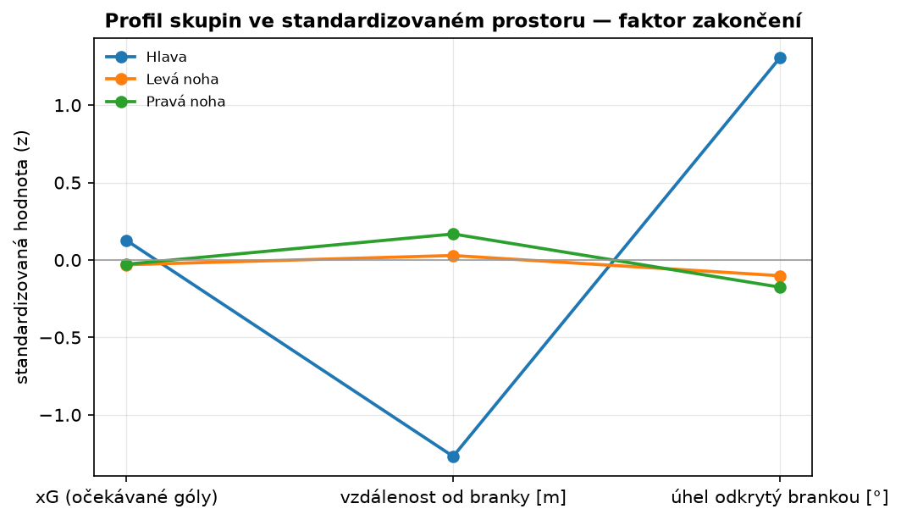

*Obrázek: Profil typů zakončení v prostoru parametrů střely*

- **Hotellingovo T²: Pravá noha vs. Levá noha**: T² = —, F(3, 743) = —, nelze ověřit → na α = 0,05 **H0 nezamítáme** (efekt prokázán nebyl) — profil skupin se liší jako celek
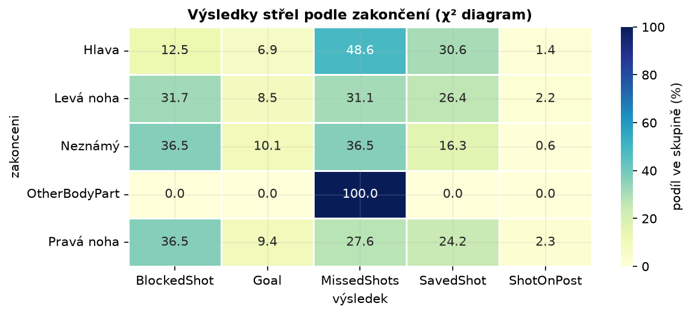

*Obrázek: Kontingence zakončení × výsledek*

- **χ² test nezávislosti zakončení × výsledek**: χ²(16) = 32,95, Cramérovo V = 0,091, p = 0,0075 → na α = 0,05 **H0 zamítáme** (efekt prokázán) — skupiny se liší i úspěšností, ne jen polohou
### Herní situace (situation) — 992 střel, 4 kategorií

**Parametr xG (očekávané góly) podle faktoru situace**

| skupina            | n        | průměr   | směrodatná odchylka   | medián   | 1. kvartil   | 3. kvartil   | minimum   | maximum   |
|:-------------------|:---------|:---------|:----------------------|:---------|:-------------|:-------------|:----------|:----------|
| Standardní situace | 52,0000  | 0,1184   | 0,1722                | 0,0456   | 0,0213       | 0,0894       | 0,0103    | 0,7394    |
| Otevřená hra       | 786,0000 | 0,0909   | 0,1267                | 0,0462   | 0,0240       | 0,0861       | 0,0086    | 0,7087    |
| Roh                | 93,0000  | 0,0601   | 0,0884                | 0,0287   | 0,0187       | 0,0555       | 0,0127    | 0,4454    |
| Přímý kop          | 61,0000  | 0,0574   | 0,0217                | 0,0540   | 0,0433       | 0,0647       | 0,0243    | 0,1445    |

- **Jednocestná ANOVA: xG (očekávané góly) ~ situace**: F(3, 988) = 4,08, η² = 0,012, ω² = 0,009, p = 0,0068 → na α = 0,05 **H0 zamítáme** (efekt prokázán) — rozdělení je zešikmené → ANOVA doplňována Kruskal–Wallisem a Welchovou verzí
- **Leveneův test homogenity rozptylů: xG (očekávané góly)**: F = 6,07, p < 0,001 → na α = 0,05 **H0 zamítáme** (efekt prokázán) — nezamítnutí podporuje klasickou ANOVA
- **Kruskal–Wallisův test: xG (očekávané góly)**: H = 19,66, p < 0,001 → na α = 0,05 **H0 zamítáme** (efekt prokázán) — shodný závěr s ANOVA → výsledek není dán zešikmením
**Tukey HSD — prokázané rozdíly: xG (očekávané góly) (situace)**

| skupina A   | skupina B          | rozdíl průměrů   | dolní mez 95 %   | horní mez 95 %   | p-hodnota   | rozdíl prokázán   |
|:------------|:-------------------|:-----------------|:-----------------|:-----------------|:------------|:------------------|
| Přímý kop   | Standardní situace | 0,0610           | 0,0014           | 0,1205           | 0,0426      | ano               |
| Roh         | Standardní situace | 0,0583           | 0,0037           | 0,1130           | 0,0311      | ano               |

**Diagnostika předpokladů (normalita po skupinách): xG (očekávané góly)**

| faktor     | proměnná            | skupina            | n        | šikmost   | špičatost   | Shapiro–Wilk p   |
|:-----------|:--------------------|:-------------------|:---------|:----------|:------------|:-----------------|
| situace_cs | xG (očekávané góly) | Otevřená hra       | 786,0000 | 2,7075    | 7,0025      | 0,0000           |
| situace_cs | xG (očekávané góly) | Roh                | 93,0000  | 3,0763    | 8,7630      | 0,0000           |
| situace_cs | xG (očekávané góly) | Přímý kop          | 61,0000  | 1,5949    | 3,5591      | 0,0000           |
| situace_cs | xG (očekávané góly) | Standardní situace | 52,0000  | 1,9874    | 2,8928      | 0,0000           |

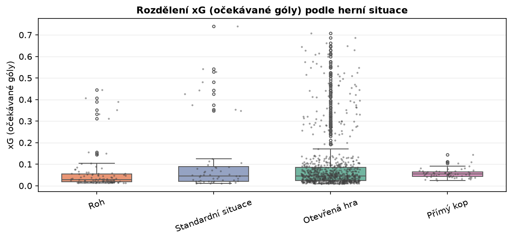

*Obrázek: xG (očekávané góly) podle herní situace*

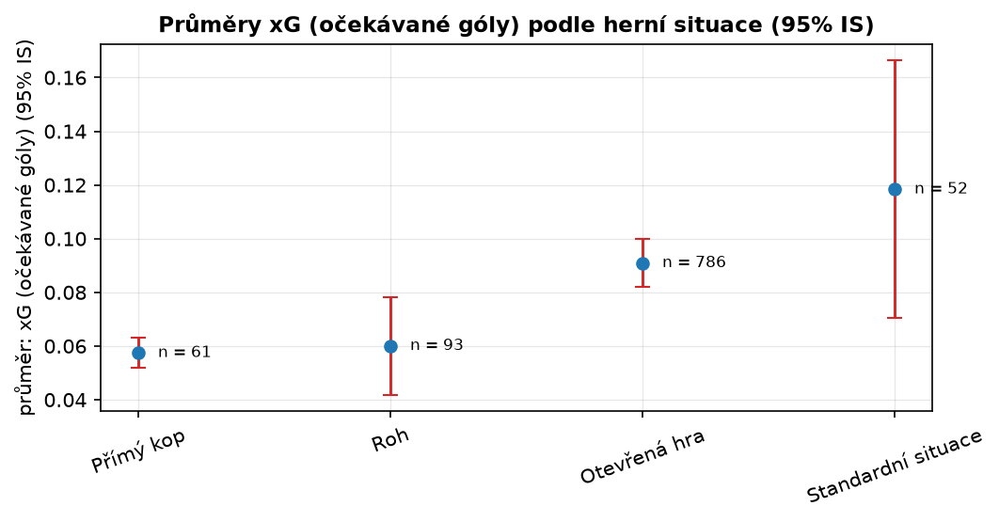

*Obrázek: xG (očekávané góly) podle herní situace*

**Parametr vzdálenost od branky [m] podle faktoru situace**

| skupina            | n        | průměr   | směrodatná odchylka   | medián   | 1. kvartil   | 3. kvartil   | minimum   | maximum   |
|:-------------------|:---------|:---------|:----------------------|:---------|:-------------|:-------------|:----------|:----------|
| Přímý kop          | 61,0000  | 27,8241  | 3,5578                | 27,5749  | 25,7427      | 29,9369      | 20,3362   | 38,1151   |
| Otevřená hra       | 786,0000 | 19,7043  | 6,5100                | 19,7300  | 14,9260      | 25,0210      | 2,8358    | 34,0919   |
| Roh                | 93,0000  | 17,6606  | 7,5411                | 17,2288  | 11,2024      | 24,5601      | 4,5448    | 32,6273   |
| Standardní situace | 52,0000  | 14,7528  | 6,6817                | 13,8771  | 10,1859      | 19,7105      | 4,0167    | 29,5199   |

- **Jednocestná ANOVA: vzdálenost od branky [m] ~ situace**: F(3, 725) = 34,98, η² = 0,126, ω² = 0,123, p < 0,001 → na α = 0,05 **H0 zamítáme** (efekt prokázán) — předpoklady ANOVA jsou v rozumné míře splněny
- **Leveneův test homogenity rozptylů: vzdálenost od branky [m]**: F = 12,24, p < 0,001 → na α = 0,05 **H0 zamítáme** (efekt prokázán) — nezamítnutí podporuje klasickou ANOVA
- **Kruskal–Wallisův test: vzdálenost od branky [m]**: H = 90,90, p < 0,001 → na α = 0,05 **H0 zamítáme** (efekt prokázán) — shodný závěr s ANOVA → výsledek není dán zešikmením
**Tukey HSD — prokázané rozdíly: vzdálenost od branky [m] (situace)**

| skupina A    | skupina B          | rozdíl průměrů   | dolní mez 95 %   | horní mez 95 %   | p-hodnota   | rozdíl prokázán   |
|:-------------|:-------------------|:-----------------|:-----------------|:-----------------|:------------|:------------------|
| Otevřená hra | Přímý kop          | 8,1198           | 5,6158           | 10,6237          | 0,0000      | ano               |
| Otevřená hra | Standardní situace | -4,9516          | -7,7093          | -2,1938          | 0,0000      | ano               |
| Přímý kop    | Roh                | -10,1635         | -13,3151         | -7,0119          | 0,0000      | ano               |
| Přímý kop    | Standardní situace | -13,0713         | -16,6642         | -9,4784          | 0,0000      | ano               |

**Diagnostika předpokladů (normalita po skupinách): vzdálenost od branky [m]**

| faktor     | proměnná                 | skupina            | n        | šikmost   | špičatost   | Shapiro–Wilk p   |
|:-----------|:-------------------------|:-------------------|:---------|:----------|:------------|:-----------------|
| situace_cs | vzdálenost od branky [m] | Otevřená hra       | 575,0000 | -0,1454   | -0,7251     | 0,0003           |
| situace_cs | vzdálenost od branky [m] | Roh                | 67,0000  | -0,0861   | -1,1851     | 0,0139           |
| situace_cs | vzdálenost od branky [m] | Přímý kop          | 48,0000  | 0,4308    | 0,5715      | 0,5356           |
| situace_cs | vzdálenost od branky [m] | Standardní situace | 39,0000  | 0,3627    | -0,7679     | 0,3216           |

![vzdálenost od branky [m] podle herní situace](22_situace_dist_m.png)

*Obrázek: vzdálenost od branky [m] podle herní situace*

![vzdálenost od branky [m] podle herní situace](23_situace_dist_m.png)

*Obrázek: vzdálenost od branky [m] podle herní situace*

**Parametr úhel odkrytý brankou [°] podle faktoru situace**

| skupina            | n        | průměr   | směrodatná odchylka   | medián   | 1. kvartil   | 3. kvartil   | minimum   | maximum   |
|:-------------------|:---------|:---------|:----------------------|:---------|:-------------|:-------------|:----------|:----------|
| Standardní situace | 52,0000  | 29,7597  | 17,3448               | 24,5113  | 17,3325      | 35,6575      | 7,4476    | 84,5006   |
| Roh                | 93,0000  | 25,8163  | 16,0636               | 18,7227  | 15,4198      | 32,0636      | 10,0427   | 76,0417   |
| Otevřená hra       | 786,0000 | 20,6953  | 10,7339               | 16,9025  | 14,4507      | 23,1408      | 6,7751    | 104,4661  |
| Přímý kop          | 61,0000  | 13,8164  | 2,4596                | 13,8864  | 12,2107      | 15,0483      | 6,4789    | 20,3396   |

- **Jednocestná ANOVA: úhel odkrytý brankou [°] ~ situace**: F(3, 725) = 17,95, η² = 0,069, ω² = 0,065, p < 0,001 → na α = 0,05 **H0 zamítáme** (efekt prokázán) — rozdělení je zešikmené → ANOVA doplňována Kruskal–Wallisem a Welchovou verzí
- **Leveneův test homogenity rozptylů: úhel odkrytý brankou [°]**: F = 12,53, p < 0,001 → na α = 0,05 **H0 zamítáme** (efekt prokázán) — nezamítnutí podporuje klasickou ANOVA
- **Kruskal–Wallisův test: úhel odkrytý brankou [°]**: H = 63,47, p < 0,001 → na α = 0,05 **H0 zamítáme** (efekt prokázán) — shodný závěr s ANOVA → výsledek není dán zešikmením
**Tukey HSD — prokázané rozdíly: úhel odkrytý brankou [°] (situace)**

| skupina A    | skupina B          | rozdíl průměrů   | dolní mez 95 %   | horní mez 95 %   | p-hodnota   | rozdíl prokázán   |
|:-------------|:-------------------|:-----------------|:-----------------|:-----------------|:------------|:------------------|
| Otevřená hra | Přímý kop          | -6,8789          | -11,3046         | -2,4531          | 0,0004      | ano               |
| Otevřená hra | Roh                | 5,1210           | 1,3183           | 8,9237           | 0,0031      | ano               |
| Otevřená hra | Standardní situace | 9,0644           | 4,1901           | 13,9388          | 0,0000      | ano               |
| Přímý kop    | Roh                | 11,9999          | 6,4294           | 17,5703          | 0,0000      | ano               |
| Přímý kop    | Standardní situace | 15,9433          | 9,5928           | 22,2938          | 0,0000      | ano               |

**Diagnostika předpokladů (normalita po skupinách): úhel odkrytý brankou [°]**

| faktor     | proměnná                 | skupina            | n        | šikmost   | špičatost   | Shapiro–Wilk p   |
|:-----------|:-------------------------|:-------------------|:---------|:----------|:------------|:-----------------|
| situace_cs | úhel odkrytý brankou [°] | Otevřená hra       | 575,0000 | 2,8037    | 11,4587     | 0,0000           |
| situace_cs | úhel odkrytý brankou [°] | Roh                | 67,0000  | 1,5235    | 1,5317      | 0,0000           |
| situace_cs | úhel odkrytý brankou [°] | Přímý kop          | 48,0000  | -0,4079   | 1,1952      | 0,2266           |
| situace_cs | úhel odkrytý brankou [°] | Standardní situace | 39,0000  | 1,4669    | 1,9055      | 0,0002           |

![úhel odkrytý brankou [°] podle herní situace](24_situace_angle_deg.png)

*Obrázek: úhel odkrytý brankou [°] podle herní situace*

![úhel odkrytý brankou [°] podle herní situace](25_situace_angle_deg.png)

*Obrázek: úhel odkrytý brankou [°] podle herní situace*

- **MANOVA (xG, dist_m, angle_deg) ~ herní situace — Wilks' lambda**: F(9,0, 1759,7) = 18,97, p < 0,001 → na α = 0,05 **H0 zamítáme** (efekt prokázán)
- **MANOVA (xG, dist_m, angle_deg) ~ herní situace — Pillai's trace**: F(9,0, 2175,0) = 18,08, p < 0,001 → na α = 0,05 **H0 zamítáme** (efekt prokázán)
- **MANOVA (xG, dist_m, angle_deg) ~ herní situace — Hotelling-Lawley trace**: F(9,0, 1133,0) = 19,59, p < 0,001 → na α = 0,05 **H0 zamítáme** (efekt prokázán)
- **MANOVA (xG, dist_m, angle_deg) ~ herní situace — Roy's greatest root**: F(3,0, 725,0) = 48,63, p < 0,001 → na α = 0,05 **H0 zamítáme** (efekt prokázán)
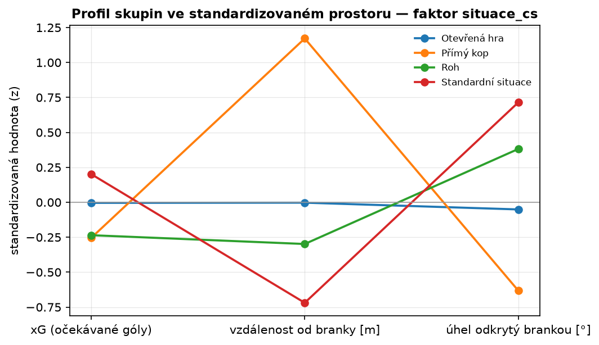

*Obrázek: Profil herních situací v prostoru parametrů střely*

- **Hotellingovo T²: Otevřená hra vs. Roh**: T² = —, F(3, 875) = —, nelze ověřit → na α = 0,05 **H0 nezamítáme** (efekt prokázán nebyl) — profil skupin se liší jako celek
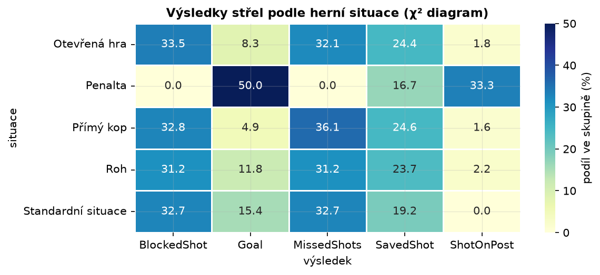

*Obrázek: Kontingence herní situace × výsledek*

- **χ² test nezávislosti herní situace × výsledek**: χ²(16) = 53,27, Cramérovo V = 0,116, p < 0,001 → na α = 0,05 **H0 zamítáme** (efekt prokázán) — skupiny se liší i úspěšností, ne jen polohou
**Závěr H1: H0 zamítáme** — typ zakončení a herní situace prokazatelně ovlivňují geometrii střely (vzdálenost od branky a úhel pohledu). Nejsilnější efekt: úhel odkrytý brankou [°] podle typu zakončení (η² = 0,169, ω² = 0,166), což je podle Cohenových měřítek (0,01 / 0,06 / 0,14) **velký** efekt. Naopak kvalita šance měřená xG se podle typu zakončení nelíší (p = 0,4427, η² = 0,002) — střelci si způsob zakončení vybírají podle toho, odkud a za jaké situace střílejí, ne podle kvality šance. Prakticky to znamená, že polohu a situaci nelze při popisu střely zaměňovat a jejich závislost musíme respektovat při redukci dimenze (H2) i v modelech úspěšnosti (H4).

## 3. H2 — redukce dimenze (PCA a faktorová analýza)

**H0:** soubor příznaků (xG, vzdálenost, úhel pohledu, X, Y) nemá žádnou společnou korelační strukturu — korelační matice je jednotková a nelze ji vystihnout menším počtem dimenzí. **H1:** společná struktura existuje a stačí K < 5 dimenzí. Analyzujeme 729 střel s úplnými souřadnicemi (penalty vyňaty — nulová variabilita polohy by matici zkreslila); příznaky jsou standardizovány, protože mají různé jednotky.

**Konstanty standardizace pro tuto množinu**

| proměnná                 | průměr   | směrodatná odchylka   |
|:-------------------------|:---------|:----------------------|
| xG (očekávané góly)      | 0,0842   | 0,1217                |
| vzdálenost od branky [m] | 19,7862  | 6,9106                |
| úhel odkrytý brankou [°] | 21,1979  | 11,8327               |
| X [jednotky hřiště]      | 83,5951  | 7,0235                |
| Y [jednotky hřiště]      | 50,4444  | 13,8109               |

- **Bartlettův test sférickosti**: χ²(10) = 2959,2, p < 0,001 → na α = 0,05 **H0 zamítáme** (efekt prokázán) — korelační matice se výrazně liší od jednotkové → redukce má smysl
- **Kaiser–Meyer–Olkin (MSA)**: celkové 0,584; nejslabší proměnná „Y [jednotky hřiště]“ s 0,158. Měřítko: > 0,8 skvělé, > 0,7 dobré, > 0,6 uspokojivé, < 0,5 by redukce nebyla na místě — podmínka splněna.
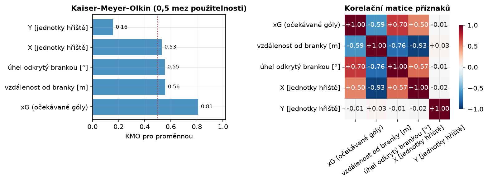

*Obrázek: KMO a korelační matice příznaků*

**Kolik dimenzí nechat — srovnání kritérií**

| kritérium                |   počet dimenzí |
|:-------------------------|----------------:|
| Kaiser (λ > 1)           |               1 |
| graf úpatí (výrazný lom) |               2 |
| paralelní analýza        |               1 |
| akumulovaných ≥ 70 %     |               2 |
| akumulovaných ≥ 80 %     |               2 |

**Vlastní čísla a zátěže komponent (PCA)**

| komponenta   | vlastní číslo λ   | podíl rozptylu (%)   | akumulováno (%)   | zátěž: xG (očekávané góly)   | zátěž: vzdálenost od branky [m]   | zátěž: úhel odkrytý brankou [°]   | zátěž: X [jednotky hřiště]   | zátěž: Y [jednotky hřiště]   |
|:-------------|:------------------|:---------------------|:------------------|:-----------------------------|:----------------------------------|:----------------------------------|:-----------------------------|:-----------------------------|
| K1           | 3,0368            | 60,7363              | 60,7363           | -0,7885                      | 0,0223                            | 0,5173                            | -0,3318                      | 0,0072                       |
| K2           | 0,9997            | 19,9947              | 80,7310           | 0,9513                       | 0,0068                            | 0,2745                            | -0,0502                      | -0,1306                      |
| K3           | 0,6401            | 12,8016              | 93,5326           | -0,8685                      | 0,0254                            | 0,2909                            | 0,3977                       | -0,0488                      |
| K4           | 0,2937            | 5,8744               | 99,4069           | -0,8689                      | -0,0023                           | -0,4604                           | -0,1514                      | -0,1007                      |
| K5           | 0,0297            | 0,5931               | 100,0000          | 0,0312                       | 0,9993                            | -0,0219                           | -0,0027                      | 0,0017                       |

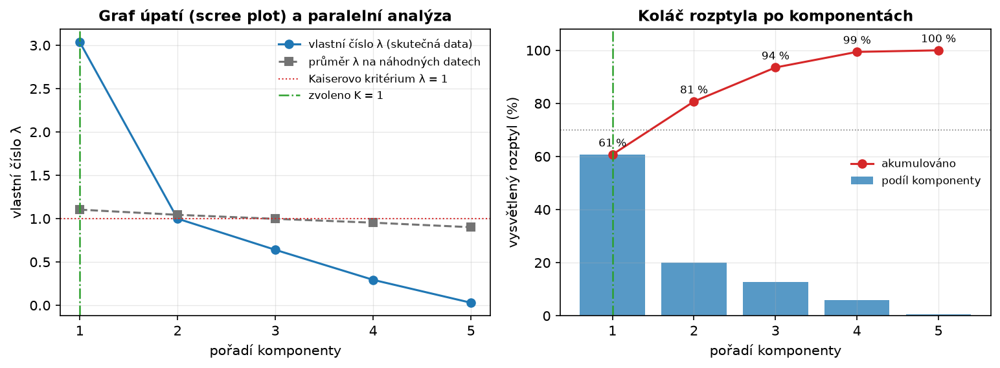

*Obrázek: Graf úpatí, Kaiserovo kritérium a paralelní analýza*

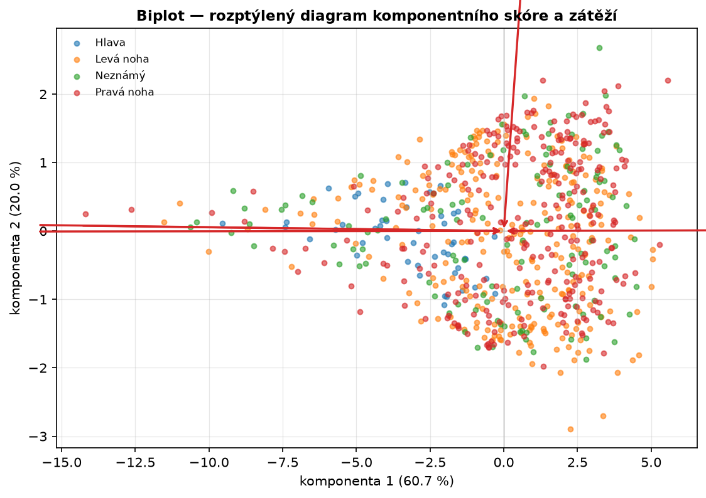

*Obrázek: Rozptýlený diagram komponentního skóre*

**Faktorová analýza po varimax rotaci (komunality)**

| proměnná                 | zátěž F1   | zátěž F2   | komunalita h²   | specificita ψ²   | max |zátěž| faktor   |
|:-------------------------|:-----------|:-----------|:----------------|:-----------------|:---------------------|
| xG (očekávané góly)      | 0,7887     | -0,0110    | 0,6222          | 0,3778           | F1                   |
| vzdálenost od branky [m] | -0,9502    | 0,0469     | 0,9050          | 0,0950           | F1                   |
| úhel odkrytý brankou [°] | 0,8688     | -0,0113    | 0,7549          | 0,2451           | F1                   |
| X [jednotky hřiště]      | 0,8680     | -0,0389    | 0,7549          | 0,2451           | F1                   |
| Y [jednotky hřiště]      | 0,0110     | 0,9997     | 0,9995          | 0,0005           | F2                   |

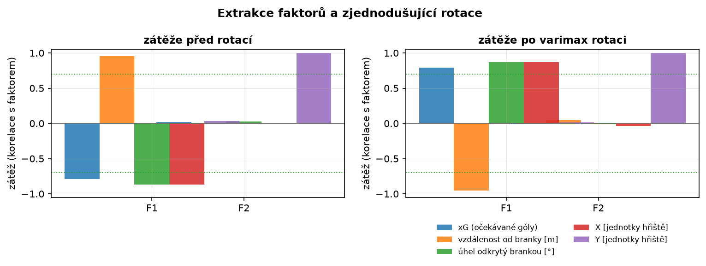

*Obrázek: Zátěže před a po rotaci*

- F1: vzdálenost od branky [m] (−0.95), úhel odkrytý brankou [°] (+0.87), X [jednotky hřiště] (+0.87), xG (očekávané góly) (+0.79) — protiklad dvou skupin znaků
- F2: Y [jednotky hřiště] (+1.00)
**Závěr H2: H0 zamítáme** — na α = 0,05 prokazujeme společnou korelační strukturu: z 5 příznaků stačí **1 komponenta** (Kaiserovo kritérium ani paralelní analýza nechtějí více) — vysvětluje **60,7 %** celkového rozptylu; na 2 komponenty se dostaneme na 80,7 %. Redukce má obsažový základ: geometrické veličiny (vzdálenost, úhel, X, Y) jsou jen různými pohledy na touž věc — polohu střelce — a xG je na ni vázáno. První komponenta je tedy „osou obtížnosti šance“ a pro shlukování (H3) pracujeme v 2 rozměrech, abychom neshodili i sekundární strukturu. Pozor: celkové KMO je jen 0,584 (nejslabší „Y [jednotky hřiště]“ s 0,158), takže redukci bereme jako orientační zkrácení dat, ne jako důkaz, že ostatní rozměry jsou zbytečné. Po rotaci je struktura čitelnější: zátěže se přiblížily ±1 nebo 0 (nekorelované faktory, korelace F1–F2 = 0,00). Citlivost: po vyloučení 23 odlehlých střel (Mahalanobisovo D², kritérium χ²) se zátěže změnily nejvýše o 0,02 a podíl vysvětleného rozptylu o 0,7 procentního bodu → struktura není vykouzlena extrémy.

## 4. H3 — shluková struktura střel

**H0:** soubor střel nemá žádnou přirozenou skupinovou strukturu — rozdělení příznaků je spojitý „mrak“ a jakýkoli rozklad na shluky je umělý. **H1:** v datech existují přirozené skupiny. Shlukujeme 729 střel se Standardizovanými příznaky vzdálenost od branky [m], úhel odkrytý brankou [°], xG (očekávané góly), Y [jednotky hřiště] (Eukleidovská metrika; penalty jsou vyňaty, protože mají nulovou variabilitu polohy). Počet shluků volíme podle indexů kvality, ne podle chuti.

**Indexy kvality shlukování (K-means)**

| K      | silhouette   | Calinski–Harabasz   | Davies–Bouldin   | WSS (within)   |
|:-------|:-------------|:--------------------|:-----------------|:---------------|
| 2,0000 | 0,5039       | 454,3750            | 0,9190           | 1792,0000      |
| 3,0000 | 0,3594       | 478,3689            | 0,9996           | 1256,3525      |
| 4,0000 | 0,3882       | 558,2445            | 0,8694           | 879,7853       |
| 5,0000 | 0,3525       | 514,7986            | 0,9302           | 757,5066       |
| 6,0000 | 0,3469       | 499,4887            | 0,9357           | 653,7535       |
| 7,0000 | 0,3464       | 520,1136            | 0,9238           | 547,1346       |
| 8,0000 | 0,3415       | 512,6893            | 0,8956           | 487,1548       |

**Kolik shluků — srovnání kritérií**

| kritérium                   | počet shluků   |
|:----------------------------|:---------------|
| silhouette (max)            | 2,0000         |
| Davies–Bouldin (min)        | 4,0000         |
| loket (WSS)                 | 3,0000         |
| shoda s hierarchickým řezem | 2,0000         |

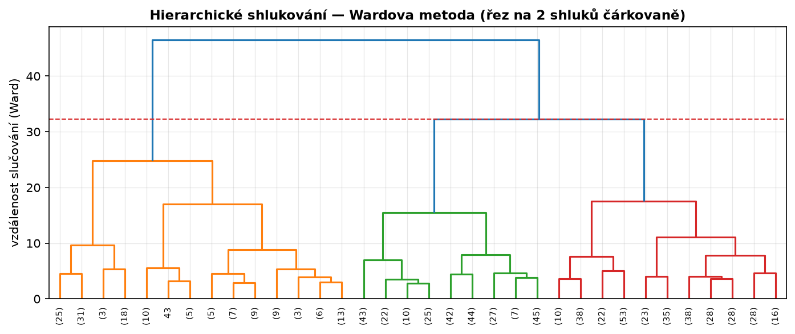

*Obrázek: Dendrogram Wardovy metody*

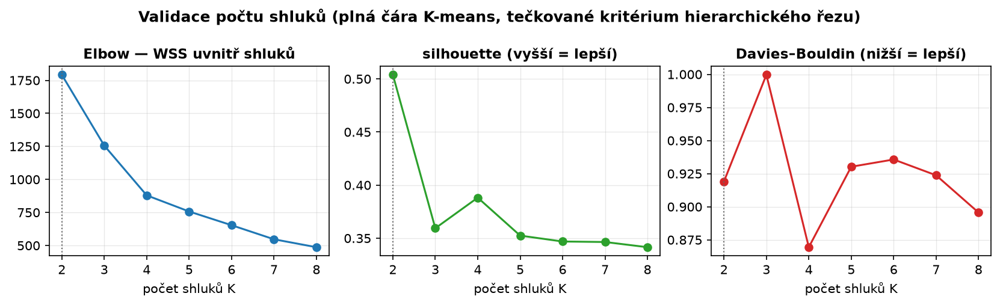

*Obrázek: Validace počtu shluků*

- **Permutační test struktury (silhouette)**: silhouette = 0,503, náhodný průměr -0,005, maximum z permutací 0,089, p = 0,0050 → na α = 0,05 **H0 zamítáme** (efekt prokázán) — skutečná silhouette výrazně přesahuje náhodu → shluky nejsou artefakt
- **Stabilita řešení (split-half ARI, 100 opakování)**: průměr 0,766 (95% interval 0,434–0,977); ARI shoda Wardovy metody a K-means 0,714. Řešení je stabilní — hranice mezi shluky jsou pozvolné (data spojitá), což u fotbalových dat očekáváme.
- **Konzistence metod**: Wardova hierarchie a K-means dávají ARI = 0,714 (stejná zpráva). ARI zde není testovací statistika, jen míra shody dvou řešení.
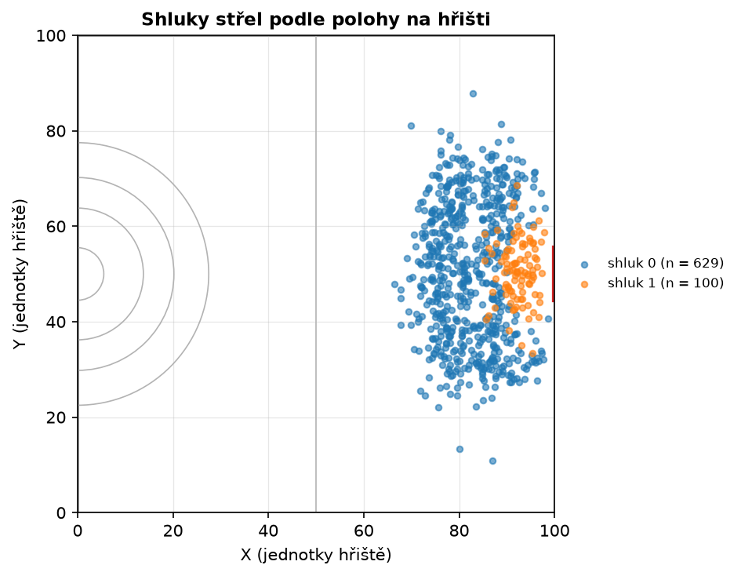

*Obrázek: Poloha střel podle shluku*

**Velikost a úspěšnost shluků (95% Wilsonův interval)**

| shluk   | n        | gólů    | úspěšnost   | dolní mez 95 %   | horní mez 95 %   | průměrné xG   | průměrná vzdálenost (m)   | průměrný úhel (°)   |
|:--------|:---------|:--------|:------------|:-----------------|:-----------------|:--------------|:--------------------------|:--------------------|
| shluk 1 | 100,0000 | 30,0000 | 0,3000      | 0,2189           | 0,3959           | 0,3177        | 9,1838                    | 43,7416             |
| shluk 0 | 629,0000 | 30,0000 | 0,0477      | 0,0336           | 0,0673           | 0,0471        | 21,4718                   | 17,6139             |

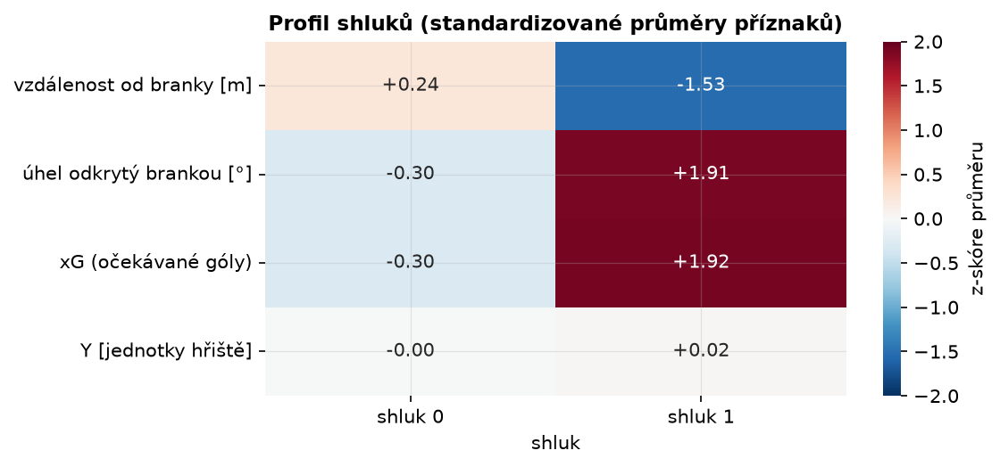

*Obrázek: Profil shluků v standardizovaném prostoru*

- **χ² test nezávislosti shluk × gól**: χ²(1) = 69,42, Cramérovo V = 0,309, p < 0,001 → na α = 0,05 **H0 zamítáme** (efekt prokázán) — shluky se liší i úspěšností, nejen polohou
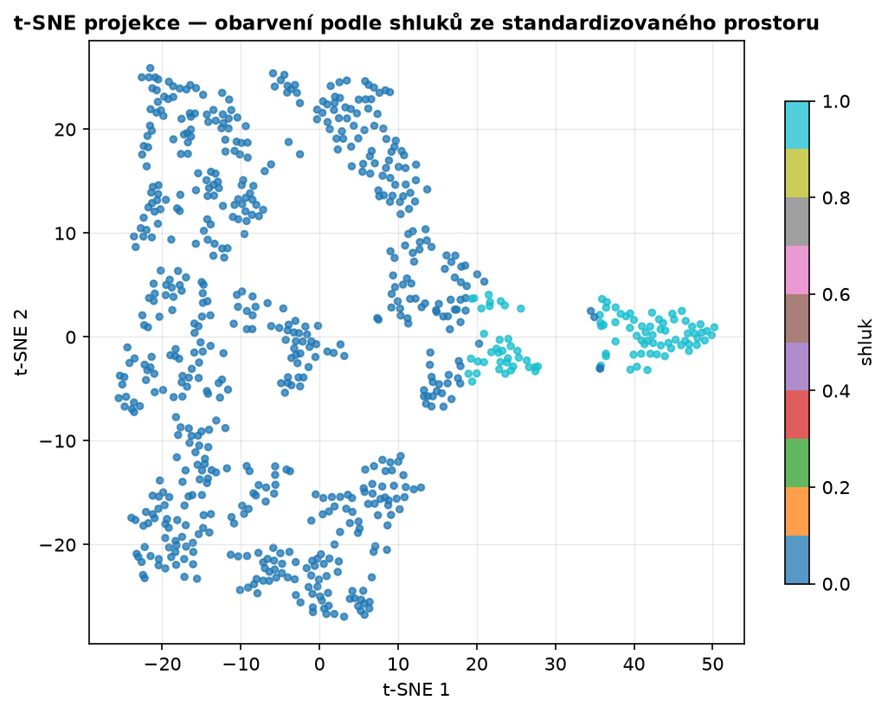

*Obrázek: t-SNE projekce s vyznačenými shluky*

**Závěr H3: H0 zamítáme** — v datech prokazujeme přirozenou skupinovou strukturu; optimální počet shluků je **2** (silhouette 0,503, permutační p = 0,0050). Nejúspěšnější shluk (shluk 1, n = 100) má úspěšnost 30,0 % oproti celkovému průměru 8,2 % — shrnutí je obsahově čitelné (poloha × kvalita šance). V t-SNE projekci se shlupy částečně promíchaly (ARI = 0,260) — struktura je do jisté míry nelineární a lineární metrika část informací ztratila. Shluky jsou dobře separovatelné (silhouette > 0,35).

## 5. H4 — model úspěšnosti střely

**H0:** ani jeden z příznaků (xG, vzdálenost od branky, úhel pohledu) neovlivňuje pravděpodobnost gólu — všechny regresní koeficienty kromě konstanty jsou nulové (model má shodnou shodu jako průměr). **H1:** alespoň jeden příznak vliv má. Modelujeme 729 střel z pole (bez penalt, ty vyčleňujeme — 6 pokutových kopů má neměnnou polohu i xG a tvoří zvláštní režim). Vysvětlovaná veličina je binární gól / bez gólu, takže logistická regrese (VMM-7); vedle toho lineární diskriminační analýza jako metoda s jinými předpoklady.

- **Celkový LR test logitního modelu (proti modelu s konstantou)**: χ²(3) = 67,05, McFaddenovo R² = 0,162, p < 0,001 → na α = 0,05 **H0 zamítáme** (efekt prokázán) — model je lepší než průměr; McFaddenovo R² u binární odezvy bývá nízké, 0,2–0,4 už platí za silné
**Koeficienty logistické regrese (OR na dané jednotce)**

| proměnná                 | β       | šance OR   | OR dolní mez   | OR horní mez   | Wald z   | p-hodnota   | jednotka   |
|:-------------------------|:--------|:-----------|:---------------|:---------------|:---------|:------------|:-----------|
| konstanta                | -2,4121 | 0,0896     | 0,0141         | 0,5681         | -2,5601  | 0,0105      | —          |
| xG (očekávané góly)      | 0,5043  | 1,6558     | 1,3193         | 2,0781         | 4,3510   | 0,0000      | ×0.1       |
| vzdálenost od branky [m] | -0,3970 | 0,6723     | 0,3349         | 1,3499         | -1,1163  | 0,2643      | ×10        |
| úhel odkrytý brankou [°] | 0,0147  | 1,0148     | 0,7329         | 1,4053         | 0,0887   | 0,9293      | ×10        |

- **Waldův test koeficientu: xG (očekávané góly) (×0.1)**: z = 4,35, OR = 1,656, p < 0,001 → na α = 0,05 **H0 zamítáme** (efekt prokázán)
- **Waldův test koeficientu: vzdálenost od branky [m] (×10)**: z = -1,12, OR = 0,672, p = 0,2643 → na α = 0,05 **H0 nezamítáme** (efekt prokázán nebyl)
- **Waldův test koeficientu: úhel odkrytý brankou [°] (×10)**: z = 0,09, OR = 1,015, p = 0,9293 → na α = 0,05 **H0 nezamítáme** (efekt prokázán nebyl)
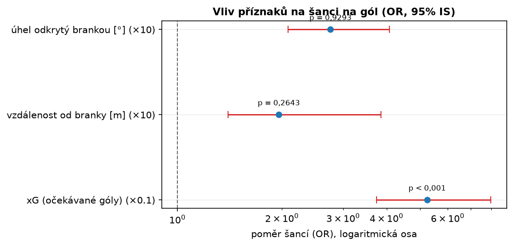

*Obrázek: Šance (OR) příznaků modelu s 95% intervaly*

**Faktory inflace rozptylu (VIF) — multikolinearita příznaků**

| proměnná   | R² proti ostatním   | VIF     |
|:-----------|:--------------------|:--------|
| konstanta  | 0,9785              | 46,4768 |
| xG         | 0,5028              | 2,0113  |
| dist_m     | 0,5838              | 2,4027  |
| angle_deg  | 0,6762              | 3,0887  |

- **LR test: přínos minut, strany hřiště a asistence nad základní model**: χ²(3) = 6,27, Δ McFadden R² = 0,0151, p = 0,0994 → na α = 0,05 **H0 nezamítáme** (efekt prokázán nebyl)
- **LR test: přínos xG nad samotnou polohou (vzdálenost + úhel)**: χ²(1) = 20,41, p < 0,001 → na α = 0,05 **H0 zamítáme** (efekt prokázán) — poloha sama o sobě střelu rozliší a xG k ní přidává další informaci
- **LR test: samotná poloha (vzdálenost + úhel) proti konstantě**: χ²(2) = 46,64, McFaddenovo R² = 0,112, p < 0,001 → na α = 0,05 **H0 zamítáme** (efekt prokázán) — i bez xG poloha vysvětluje víc než průměr — je to ale stejná informace, kterou xG obsahuje
- **LR test: přínos vzdálenosti a úhlu nad samotným xG**: χ²(2) = 2,15, p = 0,3418 → na α = 0,05 **H0 nezamítáme** (efekt prokázán nebyl) — poloha je v modelu zastoupena už přes xG — vlastní informaci navíc nemá, a proto její koeficienty ztrácejí průkaznost
- **Hosmer–Lemeshowův test kalibrace (10 složek)**: χ²(8) = 11,41, p = 0,1794 → na α = 0,05 **H0 nezamítáme** (efekt prokázán nebyl) — nezamítnutí = model správně odhaduje úroveň pravděpodobnosti
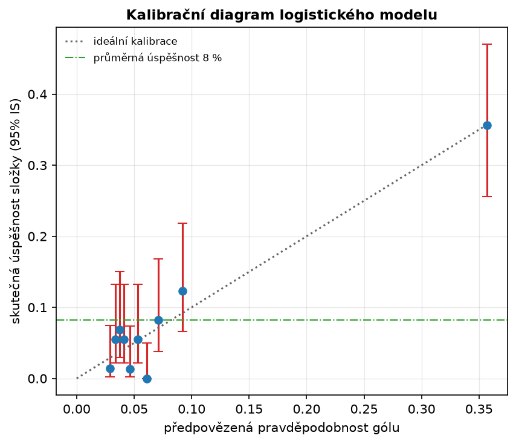

*Obrázek: Kalibrační diagram modelu*

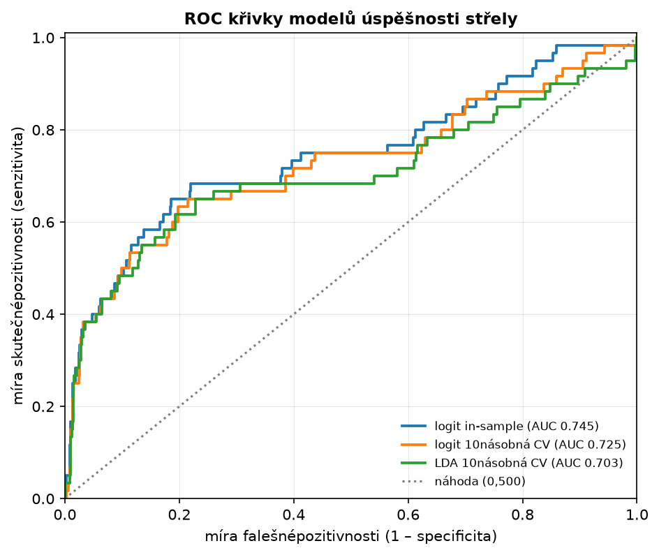

*Obrázek: ROC křivky a AUC modelů*

- **Schopnost rozlišit gól / bez gólu**: AUC logitního modelu 0,745 (95% bootstrap IS 0,656–0,824), po křížové validaci 0,725; LDA 0,703 (rozdíl 0,022 → jeden model je zřetelně lepší). AUC nad 0,7 znamená dobře rozlišující model; blížíme se hranici, kde je střelba faktorem nepředvídatelnosti.
**Strukturální koeficienty LDA (diskriminant vs. původní znaky)**

| proměnná                 | strukturální koeficient   |
|:-------------------------|:--------------------------|
| xG (očekávané góly)      | 0,9947                    |
| úhel odkrytý brankou [°] | 0,7666                    |
| vzdálenost od branky [m] | -0,6074                   |

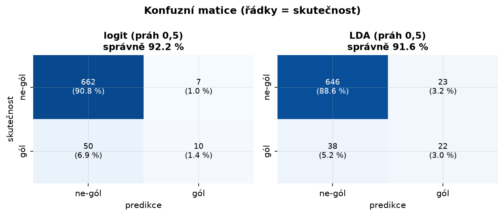

*Obrázek: Konfuzní matice obou modelů*

**Kvalita klasifikace při různých prázích**

| práh               | senzitivita   | specificita   | správně   | správně dolní mez   | správně horní mez   | predikováno gólů   | skutečných gólů   |
|:-------------------|:--------------|:--------------|:----------|:--------------------|:--------------------|:-------------------|:------------------|
| práh 0,5           | 0,1667        | 0,9895        | 0,9218    | 0,9000              | 0,9392              | 17,0000            | 60,0000           |
| práh 0.08 (Youden) | 0,6500        | 0,8146        | 0,8011    | 0,7706              | 0,8285              | 163,0000           | 60,0000           |

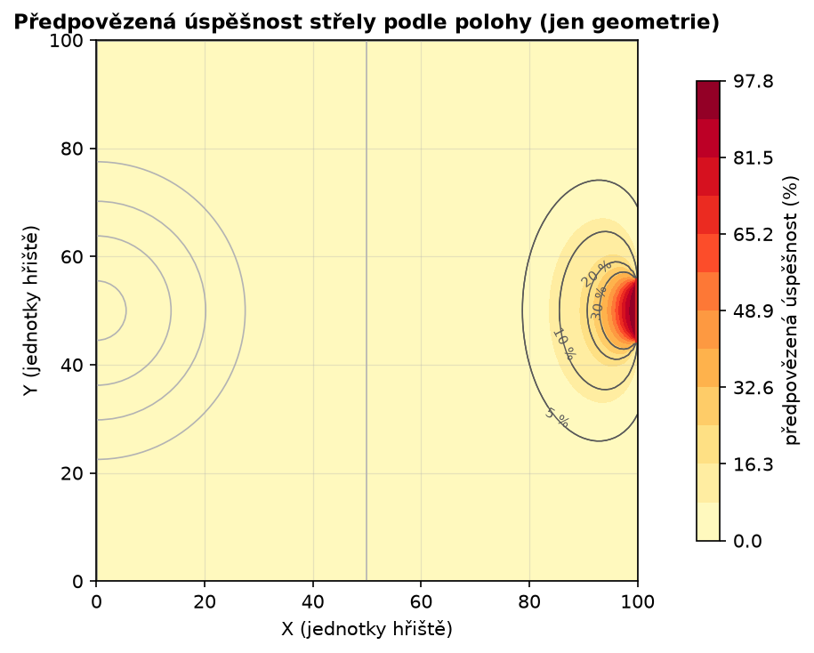

*Obrázek: Mapa úspěšnosti podle vzdálenosti a úhlu pohledu*

Penalty jsme z modelu vyčlenili: 6 pokutových kopů s úspěšností 50,0 % (95% IS 18,8–81,2 %), při xG 0.76. V modelu by uměle navyšovaly AUC (konstantní příznaky, skoro deterministický výsledek) — reálnou výpověď o střelbě z pole by zkreslily.

**Závěr H4: H0 zamítáme** — pravděpodobnost gólu je průkazně vysvětlitelná zvolenými příznaky, přičemž nositelem efektu je hlavně kvalita šance (xG). Samotná poloha (vzdálenost a úhel) sice rozliší gól od bez gólu lépe než průměr (LR test p < 0,001), ale nad rámec xG už žádnou informaci nepřidává (LR test χ²(2) = 2,15, p = 0,3418) — informace o poloze je už v xG obsažena a příznaky se v modelu o ni dělí (nejvyšší VIF 46,48, tedy silná multikolinearita vzdálenosti a úhlu). Model podle celkového testu je prokazatelně lepší než model pouze s konstantou (χ²(3) = 67,05, p < 0,001); model má AUC 0,745 a McFaddenovo R² 0,162. Každých +0,1 xG zvyšuje šanci na gól „1,66ד (95% IS 1,32–2,08); naopak každých dalších 10 m od branky ji odhaduje níže (OR 0,67, 95% IS 0,33–1,35). Model je dobře kalibrován (Hosmer–Lemeshow p = 0,1794). Po vyloučení odlehlých střel (Mahalanobisovo D², 23 řádků) se koeficienty změnily nejvýše o 0,155 a AUC z 0,745 na 0,729 → závěry nejsou dány extrémy. Zbývající nejistota není chyba modelu — střelba je ze své podstaty náhodný děj (i penalty se nepromění zdaleka vždy), proto je správnou interpretací odhad pravděpodobnosti, ne předpověď.

---

## Souhrn výsledků

**Rozsudek nad hypotézami na α = 0,05**

| hypotéza   | název                    | závěr       |
|:-----------|:-------------------------|:------------|
| H1         | H1 — zakončení a situace | H0 zamítáme |
| H2         | H2 — redukce dimenze     | H0 zamítáme |
| H3         | H3 — shluky              | H0 zamítáme |
| H4         | H4 — model úspěšnosti    | H0 zamítáme |

**H1 — H1 — zakončení a situace.** **Závěr H1: H0 zamítáme** — typ zakončení a herní situace prokazatelně ovlivňují geometrii střely (vzdálenost od branky a úhel pohledu). Nejsilnější efekt: úhel odkrytý brankou [°] podle typu zakončení (η² = 0,169, ω² = 0,166), což je podle Cohenových měřítek (0,01 / 0,06 / 0,14) **velký** efekt. Naopak kvalita šance měřená xG se podle typu zakončení nelíší (p = 0,4427, η² = 0,002) — střelci si způsob zakončení vybírají podle toho, odkud a za jaké situace střílejí, ne podle kvality šance. Prakticky to znamená, že polohu a situaci nelze při popisu střely zaměňovat a jejich závislost musíme respektovat při redukci dimenze (H2) i v modelech úspěšnosti (H4).

**H2 — H2 — redukce dimenze.** **Závěr H2: H0 zamítáme** — na α = 0,05 prokazujeme společnou korelační strukturu: z 5 příznaků stačí **1 komponenta** (Kaiserovo kritérium ani paralelní analýza nechtějí více) — vysvětluje **60,7 %** celkového rozptylu; na 2 komponenty se dostaneme na 80,7 %. Redukce má obsažový základ: geometrické veličiny (vzdálenost, úhel, X, Y) jsou jen různými pohledy na touž věc — polohu střelce — a xG je na ni vázáno. První komponenta je tedy „osou obtížnosti šance“ a pro shlukování (H3) pracujeme v 2 rozměrech, abychom neshodili i sekundární strukturu. Pozor: celkové KMO je jen 0,584 (nejslabší „Y [jednotky hřiště]“ s 0,158), takže redukci bereme jako orientační zkrácení dat, ne jako důkaz, že ostatní rozměry jsou zbytečné. Po rotaci je struktura čitelnější: zátěže se přiblížily ±1 nebo 0 (nekorelované faktory, korelace F1–F2 = 0,00). Citlivost: po vyloučení 23 odlehlých střel (Mahalanobisovo D², kritérium χ²) se zátěže změnily nejvýše o 0,02 a podíl vysvětleného rozptylu o 0,7 procentního bodu → struktura není vykouzlena extrémy.

**H3 — H3 — shluky.** **Závěr H3: H0 zamítáme** — v datech prokazujeme přirozenou skupinovou strukturu; optimální počet shluků je **2** (silhouette 0,503, permutační p = 0,0050). Nejúspěšnější shluk (shluk 1, n = 100) má úspěšnost 30,0 % oproti celkovému průměru 8,2 % — shrnutí je obsahově čitelné (poloha × kvalita šance). V t-SNE projekci se shlupy částečně promíchaly (ARI = 0,260) — struktura je do jisté míry nelineární a lineární metrika část informací ztratila. Shluky jsou dobře separovatelné (silhouette > 0,35).

**H4 — H4 — model úspěšnosti.** **Závěr H4: H0 zamítáme** — pravděpodobnost gólu je průkazně vysvětlitelná zvolenými příznaky, přičemž nositelem efektu je hlavně kvalita šance (xG). Samotná poloha (vzdálenost a úhel) sice rozliší gól od bez gólu lépe než průměr (LR test p < 0,001), ale nad rámec xG už žádnou informaci nepřidává (LR test χ²(2) = 2,15, p = 0,3418) — informace o poloze je už v xG obsažena a příznaky se v modelu o ni dělí (nejvyšší VIF 46,48, tedy silná multikolinearita vzdálenosti a úhlu). Model podle celkového testu je prokazatelně lepší než model pouze s konstantou (χ²(3) = 67,05, p < 0,001); model má AUC 0,745 a McFaddenovo R² 0,162. Každých +0,1 xG zvyšuje šanci na gól „1,66ד (95% IS 1,32–2,08); naopak každých dalších 10 m od branky ji odhaduje níže (OR 0,67, 95% IS 0,33–1,35). Model je dobře kalibrován (Hosmer–Lemeshow p = 0,1794). Po vyloučení odlehlých střel (Mahalanobisovo D², 23 řádků) se koeficienty změnily nejvýše o 0,155 a AUC z 0,745 na 0,729 → závěry nejsou dány extrémy. Zbývající nejistota není chyba modelu — střelba je ze své podstaty náhodný děj (i penalty se nepromění zdaleka vždy), proto je správnou interpretací odhad pravděpodobnosti, ne předpověď.
